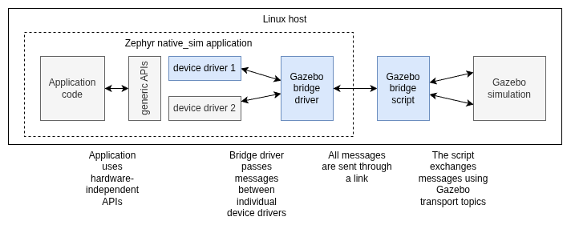
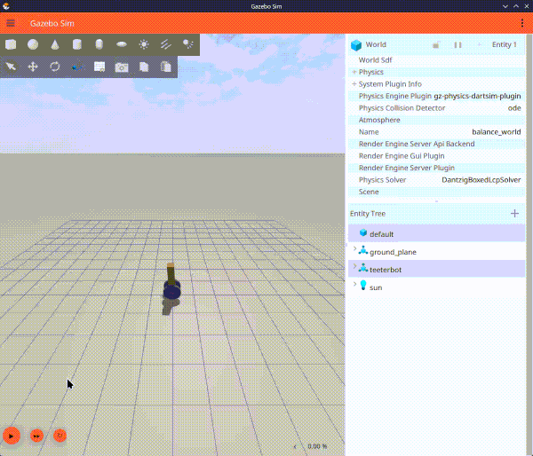
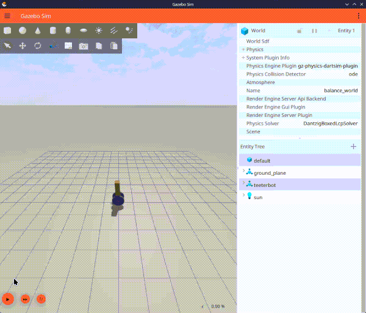

# About the project

# Introduction

The goal of this project is to enable simulation of Zephyr-based applications
for quadcopters, robots and other mechanical appliances on a local PC, with use
of a robotics simulator, without the requirement for hardware
(*Software-In-The-Loop testing*, *SIL* or *SITL* in short).

The inspiration came from [Betaflight](https://betaflight.com/),
[Ardupilot](https://ardupilot.org/) and [ROS](https://www.ros.org/), that all
provide a SITL environment by integrating with [Gazebo Simulator](https://gazebosim.org/home)
to test their various features, that normally require a working hardware
set-up - autopilots, AHRS systems, control algorithms and many others.

## Software-in-the-loop

SITL approach provides many benefits for embedded robotic application development:
- firmware can be developed regardless of project's hardware status,
- Improves safety by allowing simulation of interactions with mechanical components,
- Test iteration will be faster,
- Enables rapid changes and parametrisation of environment conditions,
  locations, materials and physical components.

This comes with a few requirements and limiations:
- Code must be designed and developed with good hardware abstraction, so that
  it's possible to plug-in drivers for simulated hardware without changing
  application logic.
- Requires development of extra drivers for simulated components.
- Development of complex models will take time and requires knowledge of the
  target simulator platform.

## Gazebo Simulator

[Gazebo](https://gazebosim.org/home) is primarly a robotics simulator - allows to create
and control physical models of robots, attach sensors and simulate various environmental conditions.
One advantage of Gazebo is the ability to interact with the simulation from other
programs and scripts through it's messaging infractructure, based on a
subscribe-publish communication protocol and protobuf messages.
Visit Gazebo

## Zephyr native

Zephyr provides a number of emulation mechanisms, one of which is the
[Native Simulator](https://docs.zephyrproject.org/latest/boards/native/native_sim/doc/index.html).
Native simulator builds result in a Linux host executable. It allows to test
Zephyr code on a developer machine. It also allows to use various emulated drivers
to test subsystems that use hardware resources. Additionally, it is possible
to connect to networks through the host.

# Architecture

To simulate Zephyr applications with Gazebo we leverage the following features of those systems:
- Zephyr device driver model, that allows building custom drivers and it's Native Simulator target.
- Gazebo transport component, that makes it possible to interact with the simulation from the outside.

As we can see, we can implement custom drivers that "talk" with the running gazebo simulation.
One of the challenges is that we can't currently run the Gazebo transport library directly from Zephyr.
To solve that problem, we designed a mechanism called the `Gazebo bridge`. The bridge consists
of two "sides", one is a Zephyr driver and another one is a Python script using the Gazebo transport.
They communicate with each other through a link, which currently is a TCP connection.
The diagram below visualises this architecture:

# Example

A concept is perhaps best visualised with an actual example.

Let's look at a simple balancing robot application. A balancing robot is a simple machine that has
only two wheels, which means it's inherently unstable. The robot can apply torque or velocity
(depending on the drive used) to the wheels to stabilise the robot. To determine the correct
drive setting, the robot estimates the tilt using an IMU sensor and an attitude estimation
algorithm and then feeds the tilt (position error) to a control algorithm (e.g. PID) that
returns the drive setting.
This example application is available in the `samples/balance_bot` directory.

Let's look at a simulation of a balancing robot model that is not controlled by any application:

Now, we can run the bridge script and the balance bot application build for native simulator
(that uses the simulation drivers) and run it. The application performs very basic
attitude estimation and PID control that is tuned for the simulated model. You can see the
model is now more or less stable (perhaps wandering a bit):

Let's see what would happen if we increase the PID Kp parameter a bit. As expected,
the robot starts to oscillate in pitch until it completely loses balance:

This example has proven we can control the simulation from the Zephyr application, and the
code shows how we can implement a hardware independent control logic that can also be tested
on the PC.

# Bottom line

As we can see, we can simulate the control logic that directly interacts with the robot -
attitude estimation, sensor fusion, motor and servo control etc.
The project could be even more useful for high-level components, that would otherwise
require a compelex testing environment, like UAV autopilots or obstacle avoidance systems.

